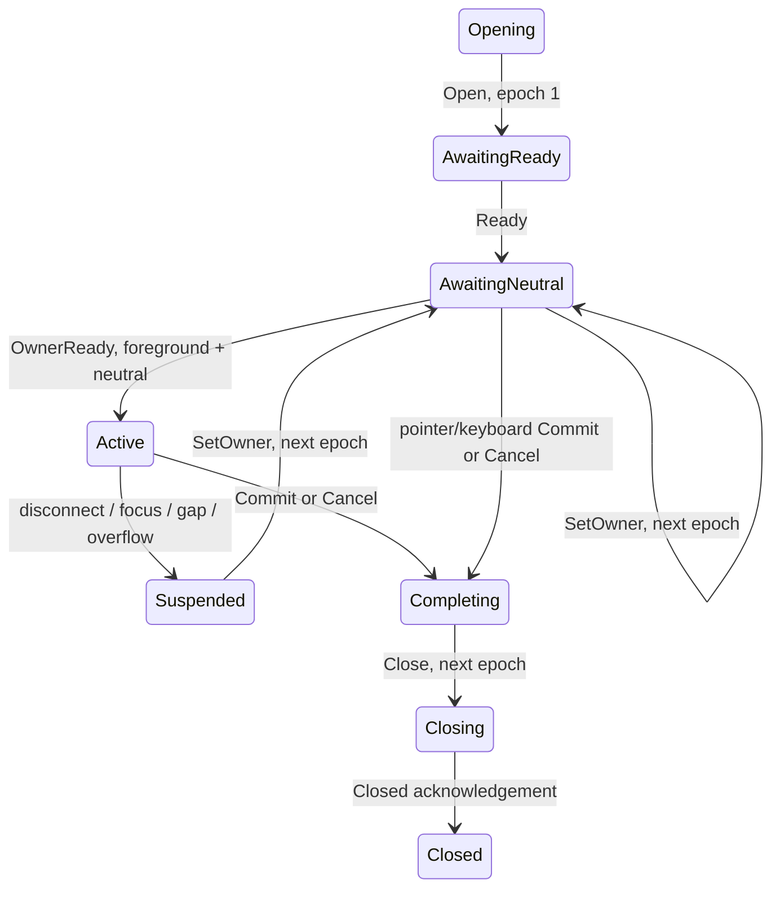

# Increment 4 Phase 1 — disconnected keyboard protocol and session model

Current production architecture and milestone status:
[MULTI_CONTROLLER.md](../MULTI_CONTROLLER.md). The agreed Xbox + DualSense
Phase 4A regressions are recorded [here](../../tools/phase4a/README.md).

Historical Phase 1 record, checkpointed as `3093db8` after validation and diff
review. Phase 2 integrates lifecycle transport; see
[`tools/phase2/README.md`](../../tools/phase2/README.md). Statements below about
unimplemented transport describe the Phase 1 boundary, not the current tree.
Phase 3 mediated controller execution is documented in
[`tools/phase3/README.md`](../../tools/phase3/README.md).

Phase 0 was reviewed and checkpointed as
`3a3f71d0432389488be3fba31f24cce603cdcbfa` before this work. Its opt-in feasibility
probe remains separate; none of its toy messages are used by this protocol.

Phase 1 adds records, validation, bounded framing and a pure session model only.
No production pipe, app startup, input routing, keyboard controller selection,
glyph selection, layout, text editing, focus handoff, or GameInput policy is
changed relative to that checkpoint. The Phase 0 routing/prompt mismatch remains
an integration task. No application opens a v2 connection or creates this model.

## Files and boundaries

- `KeyboardProtocol.cs`: version 2 envelope, immutable records, scoped device
  references, explicit owner bindings, source-generated JSON metadata.
- `KeyboardProtocolValidation.cs`: schema, peer direction, identity, capabilities,
  enum, batch, Unicode and size validation. Errors never include typed text.
- `KeyboardFramedStream.cs`: stream adapter; it creates no named pipe and does
  not authenticate a peer. One concurrent reader and one serialized writer.
- `KeyboardSession.cs`: thread-affine state and execution permissions. No native,
  WinUI, process, pipe, focus or timer calls.
- `ControllerPlayground.Input.Tests/KeyboardProtocolTests.cs`: deterministic
  framing/session tests plus a temporary current-user duplex named-pipe test.
- The existing test runner adds these checks and a protocol-only command option.

## Wire contract

Each frame is a four-byte unsigned little-endian byte count followed by UTF-8
JSON. Zero-length frames and lengths over **256 KiB** are rejected before payload
allocation. The decoder rejects invalid UTF-8, malformed JSON, duplicate members,
unknown types/fields, missing required fields and excessive nesting (24 levels).
Writing validates the entire message before touching the stream. Source-generated
JSON handles the protocol without reflection fallback.

Clean EOF before a prefix returns null and ends the framing lifetime. EOF inside
a frame, malformed content, IO failure, or cancellation during IO makes the
adapter unusable; reconnect instead of attempting to recover an unknown boundary.
Pre-cancellation before IO leaves it usable. Caller-supplied cancellation covers
the prefix and complete payload; future transport code must provide deadlines.
With `leaveOpen: true`, the caller must cancel pending IO and manage the stream.
Reads and writes must run concurrently; do not wait for a complete write before
starting the peer's read. Outbound channel/backpressure policy belongs to later
transport integration, not this per-frame bound.

Envelope fields:

| Field | Meaning |
|---|---|
| `version` | Exactly 2; incompatible versions fail explicitly |
| `connectionId` | Fresh GUID for this transport lifetime |
| `shellInstanceId`, `hostInstanceId` | Process-lifetime GUIDs |
| `sessionId` | Fresh GUID for one text request, never reused |
| `sender` | Shell (1) or Host (2), checked against message kind |
| `ownershipEpoch` | Session-local ownership/control fence |
| `sequence` | Strictly increasing per sender and session, starting at 1 |

Handshake messages use empty session ID and epoch zero in a separate handshake
scope. Hello has unknown/empty host ID; HelloAck supplies it. Connection and shell
identity must match. The advertised version range must contain v2. Full ownership
requires attribution, ownership epochs, execution acks and bounded framing.
Phase 2 adds an explicit lifecycle-only capability subset (epochs and framing);
it cannot satisfy an ownership request or accept capture/execution messages.
`KeyboardConnectionIdentity.Negotiate` correlates and validates
the pair. These metadata fields do not authenticate the operating-system peer.
Session messages start their own per-direction sequences at 1 after negotiation.

The `message.type` discriminator identifies:

- Shell: `hello`, `open`, `setOwner`, `execute`, `suspend`, `close`.
- Host: `helloAck`, `ready`, `ownerReady`, `devicesChanged`, `captureBatch`,
  `executed`, `draft`, `commit`, `cancel`, `closed`.
- Either peer, within a session: `ping`, `pong`, `error`.

Controller action and family values are canonical names, not the implicit
ordinals of the existing managed enums. Numeric aliases are rejected. The new
protocol's own enums have explicit numeric values. Device/root IDs are exactly
64 uppercase hexadecimal characters preserving all 32 opaque bytes; no GUID,
VID/PID, family or enumeration-order substitution is performed.

Bounds are 32 devices per full inventory, 64 actions per capture batch, and
16,384 UTF-16 code units per text field. Invalid Unicode is rejected; supported
text, including tabs, line breaks, NUL and supplementary characters, round-trips
without trimming or normalization. These limits do **not** change legacy text
entry. Future UI integration must report an oversized request visibly rather
than truncate it or silently fall back to an unowned legacy session.

## Ownership and lifecycle

`KeyboardDeviceRef` includes collector GUID, full device/root IDs, generation
and family. Generations are compared only within a collector. An owner binding
has a fresh binding GUID and separate shell/capture references; the references
may have different local IDs and generation numbers. Establishing that these
references represent the same physical endpoint is an external prerequisite.
Phase 1 validates references and fences; it does not prove physical identity.

The normal session flow is:



Close can also cancel startup. Transport loss faults the session, invalidates all
queued work and yields cancellation unless a terminal result was already sealed.
A new transport/host lifetime requires a fresh session. No timer, relaunch,
focus-stealing, draft application or automatic commit is performed by the model.

SetOwner, Suspend and Close are shell-issued controls requiring exactly the next
ownership epoch. Other messages must echo the current epoch. Stale epoch frames
are consumed and discarded so they cannot create a false gap in subsequent
current-epoch frames. Other session/process/connection identities and duplicate
message sequences are discarded without changing this session's watermarks.
Gaps suspend and clear pending work; they are never replayed. Invalid envelopes
fault the model. A future unannounced epoch suspends it. Recovery requires a new
owner binding/epoch and foreground neutral acknowledgement, not a late old ack.

Ready registers a capture collector and its device inventory. Complete inventory
updates are revisioned. Removal or generation replacement of the current capture
endpoint suspends ownership. Reconnecting the same ID cannot rearm the old lease.
Source-collector changes cannot silently substitute another input stream.

CaptureBatch is filtered against the exact active owner, current inventory,
foreground state, action watermark and keyboard action set. Non-owner actions,
Guide/View and other shell-only shortcuts are not retained as proposals. Owner
recovery presses and physical takeover policy remain future coordinator work;
SetOwner does not implement that user interaction on its own.

## Execution and text safety

Eligible captures produce immutable proposals, bounded together with pending
commands to 64 items. Execute must reference the exact previously observed
proposal in capture order, including its action metadata. Inventing Accept from
Back is rejected. Command IDs are contiguous and never reused within a session.
The host receives a local execution ticket; the shell replica cannot execute it.

Call `TryBeginExecution(ticket)` **immediately before** existing keyboard behavior
runs on the UI thread. Tickets are bound to the specific model instance, session,
epoch and revision. They can begin only once, in command order. Reordered UI
callbacks suspend instead of reordering text mutations. Any scope/owner/focus
revocation, disconnect, terminal outcome or transport loss clears pending work.

Local monotonic time bounds proposal-to-execution queue age to 250 ms by default,
configurable through the constructor. No clocks or native timestamps are compared
across processes. The host must apply its outgoing CaptureBatch before queueing
it for transport so its local age includes the relay delay. Issuance and actual
execution both recheck age. This is a queue-age safeguard, not an end-to-end
hardware latency guarantee.

Apply each outgoing and incoming session message to that peer's model in local
transport order. Marshal model access onto one thread. After TryBeginExecution,
the caller invokes the existing keyboard handler and sends Executed only on
success. Unknown/duplicate acknowledgements cannot execute anything. Handler
failure requires suspension/abort, not blind command retry. A terminal event
raised by a handler may seal the session before its execution ack arrives; such
a late ack is ignored.

The first Commit or Cancel seals exactly one result and revokes execution.
Commit returns exact text; it does not send a chat message. Cancel returns no
text and does not overwrite the original field. Draft snapshots have monotonic
revisions and remain recovery state only; they never become an implicit commit.
Caller-side chat-context checks and safe focus restoration remain mandatory.

## Validation and remaining integration

Run the complete runner in Debug/Release. Its duplex pipe test needs permission
to create and connect a temporary current-user pipe (the restricted execution
sandbox denies that operation).

```powershell
dotnet run --project ControllerPlayground.Input.Tests -c Debug
dotnet run --project ControllerPlayground.Input.Tests -c Release
dotnet run --project ControllerPlayground.Input.Tests -c Release -p:JsonSerializerIsReflectionEnabledByDefault=false -- --keyboard-protocol-tests
```

The last command changes only generated test runtime configuration. Rebuild/run
normally afterward to restore the complete runner's usual reflection setting;
the isolated Phase 0 toy JSON tests still use their old reflection-based codec.

Transport peer authentication/ACLs, real process/window validation, heartbeat and
launch timeouts, physical device-binding proof, ownership UI/takeover, keyboard
dispatch/glyph integration, draft recovery UI and safe focus handoffs are not
implemented here. Existing KeyboardHost scalar execution and the v1 production
pipe remain unchanged. Do not use these records to claim the prior mixed-owner
hardware behavior is resolved. Stop after Phase 1 for review.

## Verification record — October 25, 2026

- All 80 groups passed in Debug and Release: the existing 52 plus 28 protocol/
  session groups. Tests include fragmented/coalesced framing, concurrent writes,
  malformed and oversized input, cancellation, source binding, epochs, FIFO
  execution, disconnects, text outcomes and a real temporary duplex pipe.
- All 28 protocol/session groups also passed in Release with
  `System.Text.Json.JsonSerializer.IsReflectionEnabledByDefault=false`; the
  generated runtime configuration was checked, then restored to its usual setting.
- Full x64 Debug solution build passed with 113 warnings and zero errors. The
  shared library and test builds introduced no source warnings. The existing
  default full Release ReadyToRun package issue remains outside this phase.
- `git diff --check` passed. No production application/native/legacy IPC changes
  were made after the Phase 0 checkpoint. No hardware test or app deployment is
  needed to validate the disconnected library; actual owned keyboard behavior
  remains unimplemented and requires later integration/hardware acceptance.
- Phase 1 was subsequently approved and checkpointed separately as `3093db8`.
