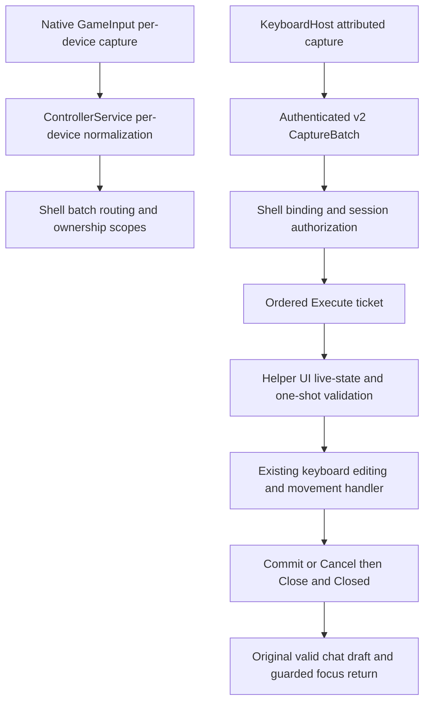

# Multi-controller architecture and milestone status

Current as of October 26, 2026. This is the current architecture entry point;
increment-specific documents retain the contracts and historical acceptance records.

## Milestone status

Xbox and PS5 DualSense multi-controller implementation and the agreed Phase 4A
end-to-end regression checks are complete. Phase 3 source is committed as
`f388c8f3893597239b4bdd5dc291ceb02dc81648`; Phase 4A evidence is recorded in
[the verification report](../tools/phase4a/README.md).

Steam Controller functionality and qualification are deferred to a future milestone,
not a blocker for the Xbox + DualSense milestone. Windows x64 packaging verification
remains separate and requires approval. Development builds and matching Debug
deployments do not establish production package, installation or upgrade support.

| Increment | Delivered boundary | Checkpoint / record |
|---|---|---|
| 1 | Per-device native capture, complete identities, independent lifecycle and additive ABI | `22bf245`; [native record](../ControllerInput/diagnostics/README.md) |
| 2 | Attributed managed batches, per-device edges/repeats/hysteresis and neutral gating | `727af96`; [managed contract](README.md) |
| 3 | Shell modal ownership, nested scopes, focus guards and takeover | `3829fab`; [shell ownership](OWNERSHIP.md) |
| 4 Phase 0 | Isolated cross-process capture/binding/latency feasibility | `3a3f71d`; [findings](../tools/phase0/PHASE0_FINDINGS.md) |
| 4 Phase 1 | Versioned protocol, bounded framing and pure session model | `3093db8`; [protocol](Keyboard/README.md) |
| 4 Phase 2 | Authenticated duplex lifecycle transport and guarded handoffs | `9cba473`; [transport record](../tools/phase2/README.md) |
| 4 Phase 3 | Shell-authorized owner-specific keyboard execution and glyphs | `f388c8f`; [execution record](../tools/phase3/README.md) |
| 4 Phase 4A | Xbox + DualSense end-to-end regressions, including Phasmophobia | [verification matrix and coverage limits](../tools/phase4a/README.md) |

## Production pipeline

The shell and helper each own one native/managed capture stream in their process.
GameInput policy remains `GameInputExclusiveForegroundInput |
GameInputEnableBackgroundGuideButton`: ordinary capture follows the foreground
process; Guide can also be observed in the background. Observation in two processes
does not grant execution in both. The shell checks ownership before Guide/View,
and KeyboardHandoff blocks shell controller shortcuts during the helper session.

Normal root navigation accepts either connected controller. Modals inherit the
initiator; nested scopes keep that owner and independent focus-return tokens.
Non-owner actions are discarded, never queued for later replay. Scope changes
discard remaining same-batch input and suppress held controls until rearmed.

For mediated keyboard sessions, the helper uses attributed `PollActions()` batches,
never its scalar executor. RT/R2 edges precede typing actions in the wire batch;
RT-only edges also retain simultaneous navigation. Existing thresholds, repeats,
layouts, Shift/Caps, X/backspace, Y/space, Menu/commit, B/cancel and movement handlers
remain in use. WinUI's unattributed gamepad/navigation key path is filtered;
physical keyboard and mouse recovery remain available.

The shell authorizes proposals using the current binding/inventory and issues
ordered execution tickets. Before UI execution the helper refreshes live capture
through the same capture method, retains its batch, checks focus/device/session,
and invokes the one-shot model gate. Validation and the synchronous handler share
the model lock; pipe IO and UI awaits do not hold it. Duplicate/stale tickets cannot
execute again. Queue bounds and the 250 ms proposal/ticket lifetime prevent replay;
expiry fails the session rather than retrying an old command.

## Identity and ownership lifetimes

| Identity / fence | Scope and meaning |
|---|---|
| Endpoint and root IDs | Complete opaque 256-bit GameInput application-local values; not GUIDs or VID/PID |
| Collector ID | One managed service lifetime; distinguishes restarted/independent capture processes |
| Connection generation | One endpoint within its native capture lifetime; never compare generations across collectors |
| Connection / shell / host IDs | Correlate the negotiated pipe lifetime and process instances |
| Session ID | One keyboard request; never reused for a later chat interaction |
| Ownership epoch and binding ID | Fence an authorization lease and its neutral acknowledgement |
| Message / capture / command sequences | Distinct ordered watermarks for transport, proposals and execution |

Cross-process binding requires a unique full endpoint/root identity match plus
family in both current inventories. The tested package pair produced matching
identities; this is not a claim of universal identity equality. Collector-local
generations stay separate. Ambiguous or different identities fail closed, without
VID/PID, enumeration-order or most-recent-input guesses. USB/Bluetooth/virtual
endpoints are not automatically merged into one physical controller.

Disconnect suspends the owner's authorization and revokes queued work. Reconnect
does not revive the previous generation or lease. After neutral, a fresh eligible
A/Cross claims only; it must not also type or activate. A new epoch/binding and
foreground neutral acknowledgement precede subsequent typing. Authorized transfers
update keyboard glyphs and the still-valid parent Friends/Chat ownership.

Commit changes only the original valid chat draft; it does not send a message.
Chat version/scope guards reject late results. Cancellation, EOF and process failure
revoke work and release the matching UI lease. Focus restoration additionally
checks context and foreground process, avoiding unrelated-app focus theft.

## Protocol, compatibility and diagnostics

V2 uses a separate Windows-session-qualified local pipe with current-user access,
OS-observed peer PID/session/package/path checks and validated helper HWND ownership.
One continuous reader and one serialized writer serve each connection. Hello/Ack
negotiate capabilities; ownership-required requests never silently downgrade.
Messages are bounded to 256 KiB, text to 16,384 UTF-16 units, and proposal/command
work to the existing bounded queues. Startup, callbacks, writes, liveness and close
have explicit deadlines. A result requires the terminal Close/Closed exchange.

Legacy native exports, managed `PollAction()`, the old pipe and explicit
`CONTROLLERPLAYGROUND_KEYBOARD_LEGACY=1` remain compatibility paths. They do not
provide mediated ownership guarantees. Lifecycle-only v2 diagnostic sessions remain
supported. `ActionReceived` and the returned batch represent the same actions:
route one, not both. Root-only unattributed Guide fallback never fabricates an owner.

Phase 0 observers, Phase 2 smoke hooks and native/managed monitors are opt-in
diagnostics, not alternate production executors. Run standalone controller monitors
with shell/helper closed. Keep diagnostic markers out of normal deployments.
Debug traces record input/routing metadata, not chat text or credentials.

## Verification and remaining work

Phase 4A reran all 109 groups in Debug and Release, all 28 protocol/session groups
with JSON reflection disabled, and the managed/native ABI smoke. The user reported
the agreed Xbox + DualSense surface, ownership, keyboard, recovery and Phasmophobia
launch/resume/exit checks work. The report distinguishes those attestations from
automated UI simulation. Transport variants were not recorded, non-owner-only
unplug was not separately attested, and new hardware fault injection did not force
callback delays; automated tests cover delayed callbacks. Other games, package
identities, controller families and release packages are not qualified.

Tracked limits and deferred work:

- Steam Input Desktop Layout can inject independent keyboard/mouse actions alongside
  GameInput. It was disabled for accepted testing; no workaround or reconfiguration
  is introduced by this milestone.
- Default Release ReadyToRun fails with existing NETSDK1094. Full Debug builds and
  Release compilation with command-only `PublishReadyToRun=false` passed; the
  workaround is not a packaging fix.
- Windows x64 install/upgrade/signing/publish validation requires separate approval.
  The Debug hash-verifying update script copies selected files, not a complete package.
- ARM64/x86 are unqualified; native ARM64 solution mapping and copy paths select x64.
- Production native shutdown ordering, retained tombstones, broader UI automation,
  and eventual retirement/isolation of migration paths remain technical debt.
- Steam Controller-specific behavior and a general alternative cross-process
  binding strategy remain future work; neither is silently inferred from this acceptance.

No packaging verification or additional production implementation is authorized by
the completion of these documentation updates.
